# AWS Data Engineering Capstone: Global Fisheries Data Lake

Building a small serverless data lake on AWS without step-by-step guidance: raw CSV files are
converted to Parquet, stored in S3, catalogued with AWS Glue and analysed with SQL in Amazon
Athena. Capstone project of the AWS Academy Data Engineering course (December 2025).

**Stack:** Python (pandas, pyarrow), AWS Cloud9, S3, AWS Glue (crawler, Data Catalog), Amazon Athena (SQL, views)

## Data

The [Sea Around Us](https://www.seaaroundus.org/) dataset: global fisheries catches from 1950 to
2018 by year, fishing country, area, species, tonnes and landed value (in 2010 US dollars).
Three files were used:

| File | Content |
|---|---|
| `SAU-GLOBAL-1-v48-0.csv` | Global high seas |
| `SAU-HighSeas-71-v48-0.csv` | Pacific, Western Central high seas |
| `SAU-EEZ-242-v48-0.csv` | Fiji exclusive economic zone (EEZ) |

## Architecture

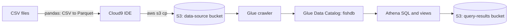

## Steps

### 1. Environment and storage

- Created a Cloud9 IDE (t2.micro EC2 instance in the capstone VPC).
- Created two S3 buckets in us-east-1: one for the data files and one for Athena query results.
- Inspected the CSV files, installed pandas, pyarrow and fastparquet, converted the global
  high seas file to Parquet and uploaded it to S3 with the AWS CLI.

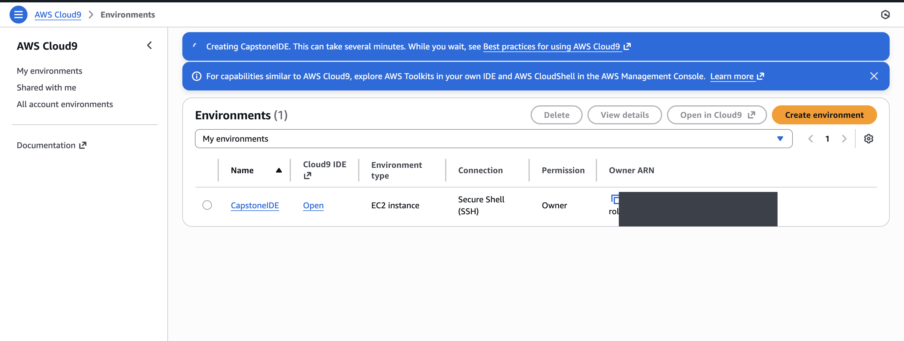
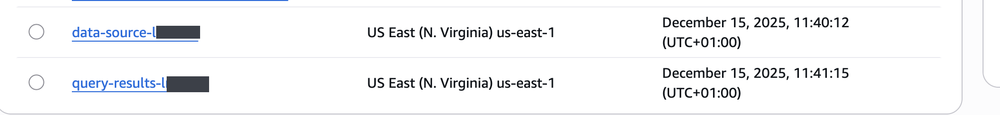
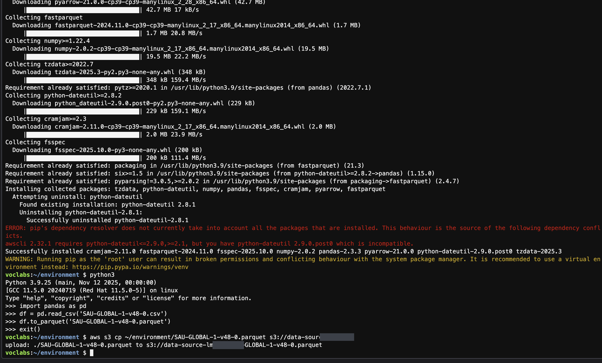

### 2. Cataloguing with AWS Glue

- Created the `fishdb` Glue database and the `fishcrawler` crawler (IAM role `CapstoneGlueRole`).
- Ran the crawler to infer the schema and create the table metadata, then checked the result in Athena.

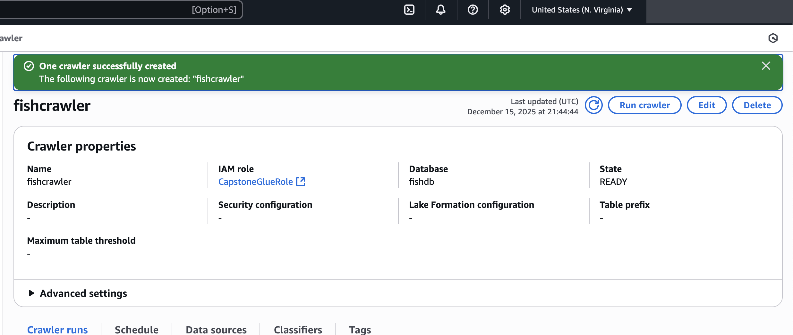
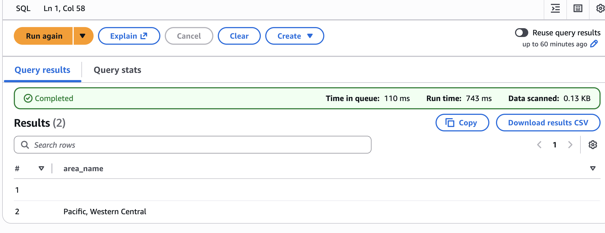

### 3. Adding a file with a different schema

The Fiji EEZ file used different column names (`fish_name` instead of `common_name`, `country`
instead of `fishing_entity`). I renamed the columns with pandas, converted the file to Parquet,
uploaded it and re-ran the crawler so that all three files sit in one queryable table.

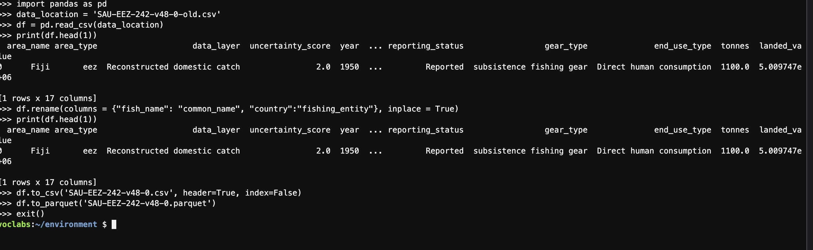
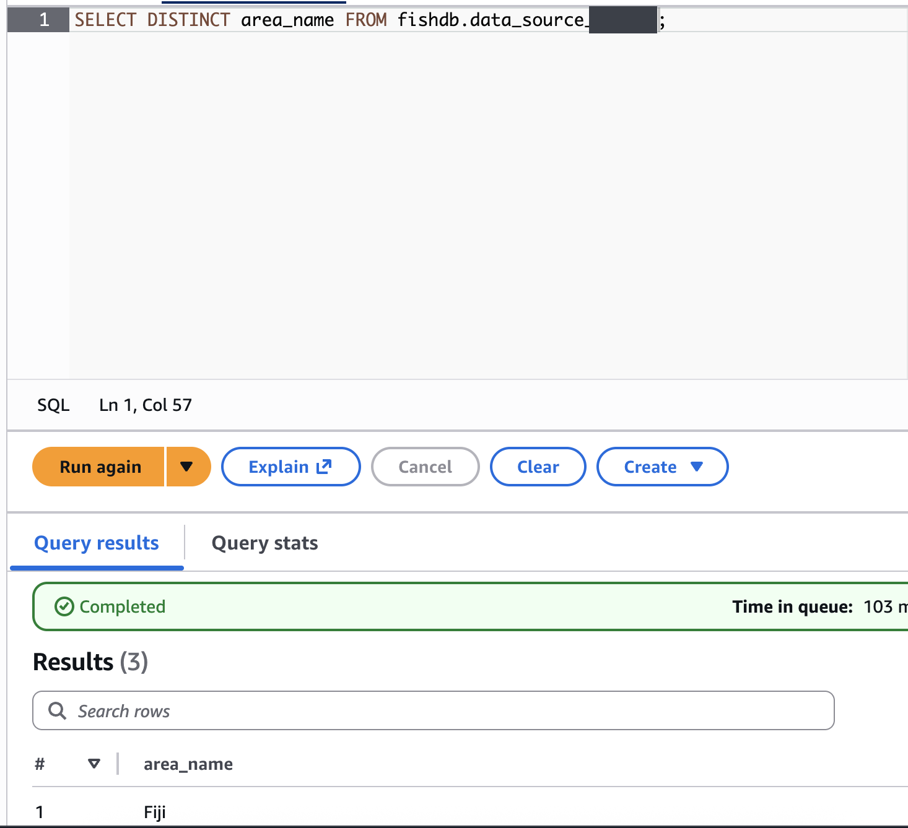

### 4. Analysis in Athena

- Value of Fiji's catch on the open seas, and on the open seas plus its own EEZ, per year since 2000.
- A `MackerelsCatch` view for mackerel catches since 2015, and queries on it by country and year.

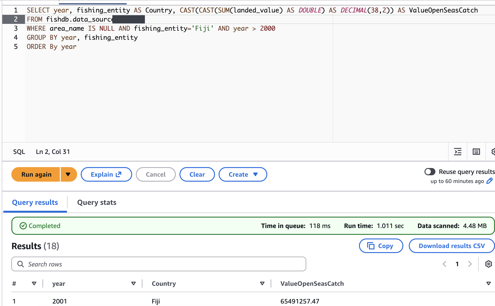
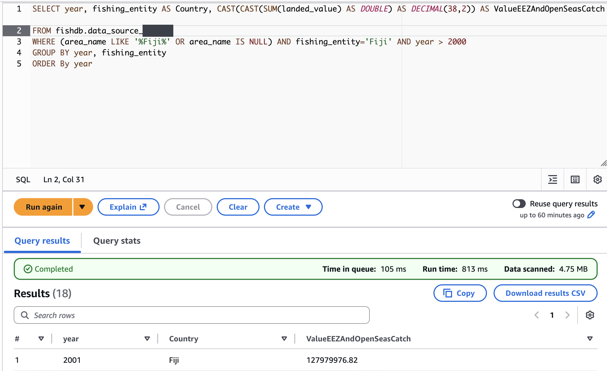
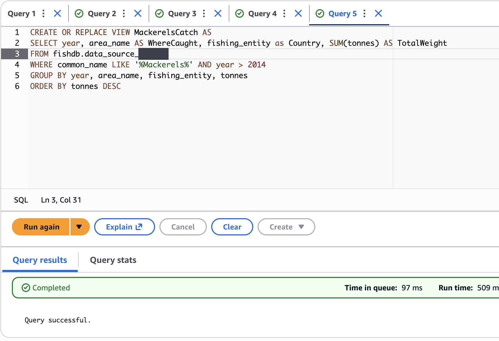
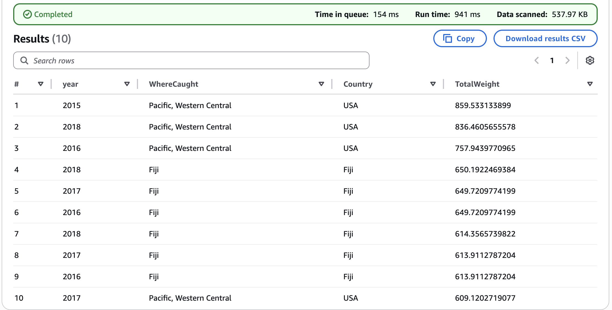

## Own queries

Beyond the required tasks I wrote three additional queries (`<table>` stands for the table the
crawler created).

**Top 5 fishing countries by total landed value**: the major market players in the data.

```sql
SELECT fishing_entity AS Country,
       CAST(SUM(landed_value) AS DECIMAL(38,2)) AS Total_Landed_Value
FROM fishdb.<table>
GROUP BY fishing_entity
ORDER BY Total_Landed_Value DESC
LIMIT 5;
```

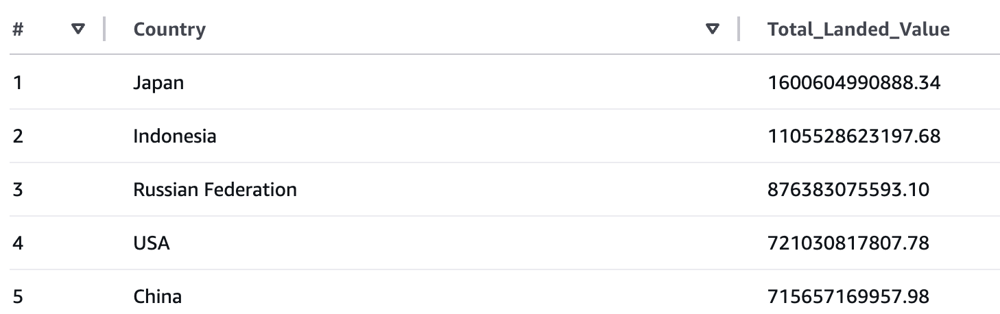

**Most valuable ocean region**: average catch value for the Pacific, Atlantic and Indian Ocean areas.

```sql
SELECT area_name,
       CAST(AVG(landed_value) AS DECIMAL(38,2)) AS Average_Catch_Value
FROM fishdb.<table>
WHERE area_name LIKE '%Pacific%' OR area_name LIKE '%Atlantic%' OR area_name LIKE '%Indian%'
GROUP BY area_name
ORDER BY Average_Catch_Value DESC;
```

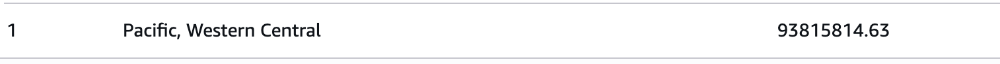

**Global value trend**: total landed value of all countries per year.

```sql
SELECT year,
       CAST(SUM(landed_value) AS DECIMAL(38,2)) AS Global_Annual_Value
FROM fishdb.<table>
GROUP BY year
ORDER BY year DESC;
```

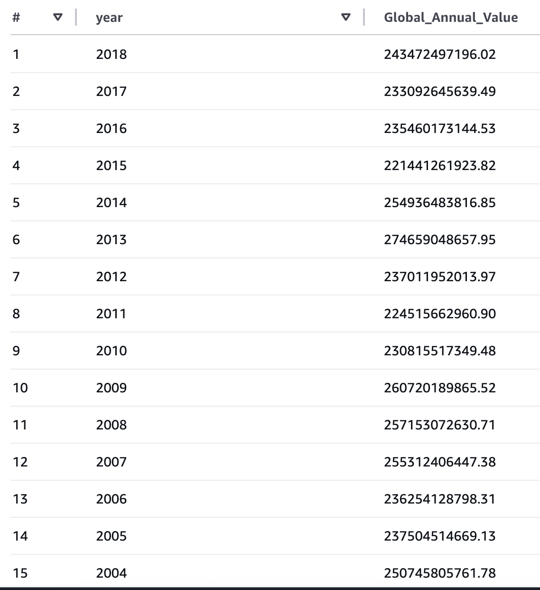

## Results

- Japan, Indonesia, Russia, the USA and China have the highest total landed value in the data.
- In the high seas data used here only the Pacific, Western Central region matched the ocean filter.
- The global landed value stays in a band of roughly 220 to 275 billion USD a year between 2004 and 2018.

Account identifiers and personal details are redacted in the screenshots.
